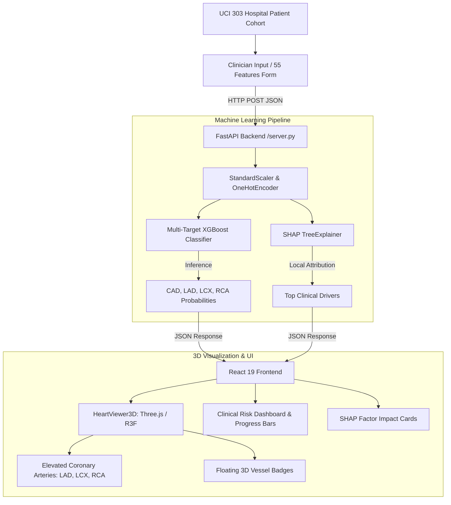

# CardioRisk 3D: Cardiovascular Risk Visualization & Multimodal Prediction
### INNOTECH 2026 — Multimodal AI Hackathon (Track A)

[](https://fastapi.tiangolo.com)
[](https://react.dev)
[](https://threejs.org)
[](https://xgboost.readthedocs.io)
[](https://shap.readthedocs.io)
[](https://opensource.org/licenses/MIT)

> **Interactive 3D Anatomical Digital Twin & Localized Coronary Stenosis Risk Assessment with SHAP Clinical Explainability.**

---

## 📋 Table of Contents
- [Overview & Clinical Motivation](#-overview--clinical-motivation)
- [Key Features](#-key-features)
- [Coronary Arterial Tree & Risk Criteria](#-coronary-arterial-tree--risk-criteria)
- [System Architecture](#-system-architecture)
- [Project Structure](#-project-structure)
- [Getting Started (Git Bash / Windows / Linux)](#-getting-started)
- [REST API Endpoints](#-rest-api-endpoints)
- [Team & Acknowledgements](#-team--acknowledgements)
- [Medical Safety Disclaimer](#-medical-safety-disclaimer)

---

## 💡 Overview & Clinical Motivation

Coronary Artery Disease (CAD) is the leading cause of mortality worldwide. Traditional risk calculators (such as Framingham or SCORE) generate abstract numerical scores that fail to convey **spatial, vessel-specific anatomical risk** to both cardiologists and patients.

**CardioRisk 3D** transforms statistical cardiology by combining **multi-target machine learning** with a **real-time 3D anatomical heart digital twin**. Rather than simply predicting a generalized disease probability, the system:
1. Predicts **overall CAD presence**.
2. Predicts **vessel-specific stenosis ($\ge 50\%$ occlusion)** across the three primary coronary arteries:
   - **LAD** (*Left Anterior Descending* — the "Widowmaker")
   - **LCX** (*Left Circumflex Artery*)
   - **RCA** (*Right Coronary Artery*)
3. Color-codes and illuminates the vessels directly on an **anatomical 3D heart model in real time**.
4. Provides transparent clinical interpretability via **SHAP (SHapley Additive exPlanations)** to uncover the exact biomarkers driving the prediction.

---

## ✨ Key Features

- **Interactive 3D Anatomical Heart Digital Twin:**
  - High-definition 3D realistic cardiac model with ventricles, atria, and aortic arch.
  - Bold, luminescent coronary artery branches (**LAD**, **LCX**, and **RCA**) designed for clear visibility from any angle.
  - Floating 3D clinical tags attached to each vessel displaying real-time risk percentages and status.
  - **360° Spherical Orbit Controls**, animated heartbeat contraction cycle, and preset camera angles (*Anterior*, *Lateral Left*, *Right Branch*, *Top Overview*).
  - **Translucent X-Ray vs. Realistic Solid Modes:** Easily toggle between photorealistic heart textures and glassmorphic see-through myocardium.

- **Full 55-Biomarker Clinical Input Form:**
  - Covers all 55 features from the UCI Z-Alizadeh Sani clinical cohort without omitting risk factors.
  - Grouped into 6 clinical tabs: *Demographics & Core Vitals*, *Medical History*, *Physical Exam*, *Symptoms & Angina*, *ECG & Echocardiogram*, and *Laboratory Biomarkers*.
  - **Live Search Filter:** Instant keyword lookup for any biomarker (e.g., `Potassium`, `ST Elevation`, `BMI`, `Creatinine`).

- **303 Real Hospital Patient Cases:**
  - Step through rows `#0` to `#302` to load real hospital patient records and compare AI predictions against **actual catheterization angiography ground truth**.
  - One-click benchmark clinical presets (*Healthy/Low Risk*, *Acute LAD Stenosis*, *Severe Multi-Vessel CAD*).

- **SHAP Explainability Engine:**
  - Local feature attribution shows the top 5 clinical factors increasing or reducing patient risk.
  - Distinguishes protective factors (e.g., normal EF, normal ECG) from critical risks (e.g., typical chest pain, regional wall motion abnormalities, elevated LDL).

---

## 🫀 Coronary Arterial Tree & Risk Criteria

Predictions align with standard **ESC / AHA cardiology risk stratification guidelines**:

| Status | Color | Risk Range | Description & Recommended Action |
| :--- | :---: | :---: | :--- |
| **Patent** | 🟢 Green (`#10b981`) | **$< 30\%$** | Normal hemodynamic perfusion; no significant stenosis detected. Routine preventive lifestyle follow-up. |
| **Moderate** | 🟡 Amber (`#f59e0b`) | **$30\% - 60\%$** | Intermediate atherosclerotic burden. Intensive statin therapy, antiplatelets, and stress echocardiography advised. |
| **Critical Stenosis** | 🔴 Red (`#ef4444`) | **$> 60\%$** | High probability of severe lumen obstruction ($\ge 50\%$). Urgent invasive catheterization (Cath Lab) / FFR indicated. |

### Target Coronary Arteries:
- **LAD (Left Anterior Descending):** Supplies ~50% of left ventricular myocardium and interventricular septum. Occlusion leads to acute anterior STEMI ("Widowmaker").
- **LCX (Left Circumflex):** Courses along the left atrioventricular sulcus to supply the posterolateral left ventricle and left atrium.
- **RCA (Right Coronary Artery):** Supplies the right ventricle, inferior LV diaphragmatic wall, and cardiac conduction nodes (SA/AV nodes).

---

## 🏗️ System Architecture



---

## 📂 Project Structure

```text
├── cardio_model_pipeline.ipynb    # Model training, benchmarking & SHAP calibration
├── cardio_models.joblib           # Pre-trained pipelines (Preprocessors, Classifiers, Explainer)
├── cad_dataset_clean.csv          # Cleaned UCI Z-Alizadeh Sani dataset (55 features, 303 records)
├── demo_presets.json              # Benchmark case studies (Low Risk, LAD, Multi-Vessel)
├── requirements.txt               # Backend Python dependencies
├── server.py                      # FastAPI inference engine & SHAP service
└── frontend/                      # React 19 + Vite frontend
    ├── package.json               # Node dependencies
    ├── public/
    │   ├── dataset_patients.json  # 303 real hospital patient records with ground truth
    │   └── models/
    │       └── realistic_heart.glb # 3D High-Definition anatomical heart model
    └── src/
        ├── App.jsx                # Root clinical dashboard layout
        ├── components/
        │   ├── HeartViewer3D.jsx  # Three.js 3D Heart Digital Twin & coronary tubes
        │   ├── RiskDashboard.jsx  # Multi-vessel risk meters & SHAP drivers
        │   └── VitalsForm.jsx     # 55-feature categorized clinical form & search
        └── index.css              # Tailwind styling & typography
```

---

## 🚀 Getting Started

### Prerequisites
- **Python 3.9+** and `pip`
- **Node.js 18+** and `npm`
- **Git Bash** (recommended on Windows) or terminal (macOS/Linux)

---

### Step 1: Clone the Repository
Open Git Bash and clone the project:
```bash
git clone https://github.com/too-baa/cardiovascular-risk-visualisation-and-prediction.git
cd cardiovascular-risk-visualisation-and-prediction
```

---

### Step 2: Start the Backend (FastAPI)
In your terminal, set up a virtual environment and run the server:

```bash
# 1. Create and activate a virtual environment
python -m venv venv

# On Windows (Git Bash):
source venv/Scripts/activate
# On macOS / Linux:
# source venv/bin/activate

# 2. Install Python dependencies
pip install -r requirements.txt

# 3. Start the inference engine
python -m uvicorn server:app --port 8000
```
> The backend server will be live at: **`http://127.0.0.1:8000`**

---

### Step 3: Start the Frontend (React + Vite)
Open a **second Git Bash tab/window**:

```bash
# Navigate to the frontend directory
cd frontend

# Install dependencies (first time only)
npm install

# Start the Vite development server
npm run dev
```

---

### Step 4: Open in Your Browser
Open your browser and navigate to:
👉 **[http://localhost:5173](http://localhost:5173)**

---

## 📡 REST API Endpoints

The backend exposes the following endpoints:

| Method | Endpoint | Description |
| :---: | :--- | :--- |
| `GET` | `/` | API Health Check (`{"status": "healthy"}`) |
| `GET` | `/predict` | API usage information and documentation link |
| `POST` | `/predict` | Runs 55-feature inference; returns vessel stenosis risks & SHAP attributions |
| `GET` | `/docs` | Interactive Swagger UI documentation |

---

## 👥 Team & Acknowledgements

Developed for **INNOTECH 2026 — Multimodal AI Hackathon (Track A)**:

- **Tooba** — *Team Lead & Product Architect* (System Integration, UI/UX, Video Demo & Pitch)
- **Shaista** — *AI/ML Engineer* (Model Benchmarking, XGBoost/CatBoost, Stratified CV, Metrics)
- **Anamta** — *Graphics & CS Engineer* (3D Anatomical Heart Integration, Three.js Graphics, Project Report)
- **Anushka** — *Systems & ML Engineer* (SHAP Explainability Engine, API Integration, Pipeline Validation)

---

## ⚠️ Medical Safety Disclaimer

> **For Educational and Clinical Decision Support Purposes Only:**  
> CardioRisk 3D is developed as an academic hackathon prototype for multimodal AI decision support. Predictions generated by machine learning models are intended to assist clinical risk stratification and are **not a substitute for professional medical advice, clinical diagnosis, or formal diagnostic coronary angiography / cardiac catheterization**.